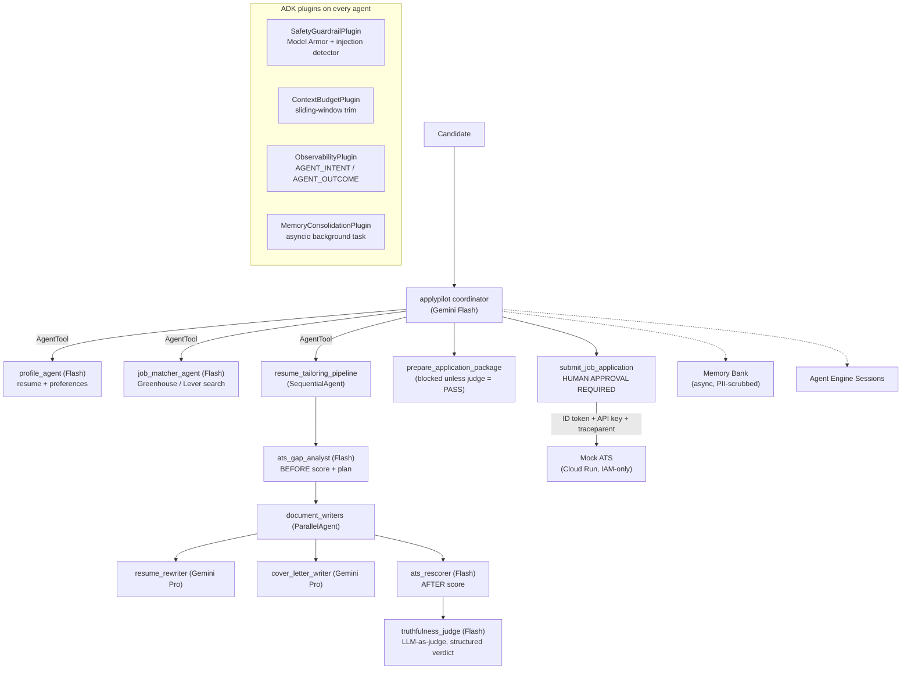

# ApplyPilot: an AI job-application co-pilot

**Track:** Concierge Agents · **Framework:** Google ADK (Python) · **Runtime:** Vertex AI Agent Engine + Cloud Run

Job seekers spend hours re-tailoring their resume and cover letter for every posting, and most
applications are filtered out by Applicant Tracking Systems (ATS) before a person reads them.
**ApplyPilot** takes a candidate's resume and preferences, finds matching jobs (Greenhouse/Lever),
scores the resume against the job description **before**, rewrites it to be ATS-friendly **without
inventing anything**, writes a matching cover letter, scores it again **after**, has an independent
judge check every claim, and submits the application **only after the candidate approves it**.

```text
You:        My resume is at samples/resumes/maya_lin_healthcare_full_stack.pdf.
            Remote full stack roles in healthcare, no crypto.
ApplyPilot: Resume loaded (SUMMARY, SKILLS, EXPERIENCE, EDUCATION found). Here are matching jobs...
You:        Tailor for #2.
ApplyPilot: Truthfulness check: PASS · ATS score 90.0 → 92.7 · tailored resume and cover letter below.
You:        Apply.
ApplyPilot: [Approval prompt: "Submit your application for Senior Engineer at CareConnect?"]  ✅ Approve
            Submitted. Application ID app_f894281df93c.
```

---

## Architecture



| Component | Where it runs | Code |
|---|---|---|
| Agent (coordinator, 7 specialists, plugins) | Vertex AI **Agent Engine** | [app/](app) |
| Mock ATS (employer application endpoint) | **Cloud Run**, IAM-protected | [mock_ats/](mock_ats) |
| Sessions / long-term memory | Agent Engine Sessions / **Memory Bank** (SQLite locally) | [app/app_utils/services.py](app/app_utils/services.py) |
| Secrets | **Secret Manager** | [app/secrets.py](app/secrets.py) |
| Guardrails | **Model Armor**, Cloud **DLP**, Gemini safety settings | [app/guardrails.py](app/guardrails.py), [app/observability/pii.py](app/observability/pii.py) |
| Telemetry | Cloud Logging, Cloud Trace, BigQuery | [app/observability/](app/observability) |
| Infrastructure | Terraform | [deployment/terraform/single-project/](deployment/terraform/single-project) |

---

## Rubric → evidence map

| # | Criterion | Evidence |
|---|---|---|
| 1.1 | Tool docstrings | Every tool has Google-style docstrings with arguments, examples and return shapes: [app/tools/](app/tools) |
| 1.2 | Descriptive naming | `<verb>_<object>` names: `load_candidate_resume`, `calculate_ats_match_score`, `submit_job_application` ([app/tools/__init__.py](app/tools/__init__.py)) |
| 1.3 | Structured I/O schemas | Pydantic models with constraints: [app/tools/schemas.py](app/tools/schemas.py); judge `output_schema=TruthfulnessReview` |
| 1.4 | Guided error recovery | Tools never raise; they return `error_code` and a `recovery_instruction` that tells the agent what to do next: [app/tools/errors.py](app/tools/errors.py) |
| 2.1 | System instructions | One shared constitution plus a ROLE / CONTEXT / PROCESS / RULES / OUTPUT prompt for each agent: [app/prompts.py](app/prompts.py) |
| 2.2 | History compaction | `EventsCompactionConfig` (summarises with the Flash model) plus the `ContextBudgetPlugin` sliding window: [app/context_management.py](app/context_management.py) |
| 2.3 | Persistent state | `VertexAiSessionService` / SQLite sessions, `user:`-scoped history, Memory Bank with `preload_memory`/`load_memory`: [app/app_utils/services.py](app/app_utils/services.py) |
| 2.4 | Async memory | `asyncio.create_task` in `MemoryConsolidationPlugin.after_run_callback`, PII-scrubbed: [app/memory.py](app/memory.py) |
| 3.1 | Multi-agent patterns | Coordinator plus `AgentTool` specialists, a `SequentialAgent` pipeline and a `ParallelAgent` for the two writers: [app/agent.py](app/agent.py) |
| 3.2 | Model routing | Flash for routing, analysis, scoring and judging; Pro for long-form writing; configurable: [app/config.py](app/config.py) |
| 3.3 | Guardrails / plugins | `SafetyGuardrailPlugin` (Model Armor + injection detector on inputs, job descriptions and outputs), Gemini safety settings, truthfulness LLM-as-judge with a gate: [app/guardrails.py](app/guardrails.py) |
| 3.4 | Human-in-the-loop | `submit_job_application` pauses with ADK tool confirmation; each decision is recorded: [app/tools/session_tools.py](app/tools/session_tools.py) |
| 4.1 | Structured logging | Cloud Logging `StructuredLogHandler` JSON with session/trace IDs: [app/observability/logging.py](app/observability/logging.py) |
| 4.2 | Intent vs. outcome | `AGENT_INTENT` / `AGENT_OUTCOME` pairs sharing an `action_id`: [app/observability/plugin.py](app/observability/plugin.py) |
| 4.3 | Distributed tracing | OpenTelemetry spans plus W3C `traceparent` sent to the Mock ATS, whose logs carry the same trace ID: [app/observability/tracing.py](app/observability/tracing.py) |
| 4.4 | PII redaction | `PIIScrubber`: Cloud DLP plus regex plus known values, applied before logs and memory are written; contact details are never stored in state: [app/observability/pii.py](app/observability/pii.py) |
| 5.1 | Eval suites | Golden agent eval with thresholds ([tests/eval/](tests/eval)) plus a deterministic golden regression suite in CI ([tests/unit/test_golden_regression.py](tests/unit/test_golden_regression.py)) |
| 5.2 | Infrastructure as code | Terraform: Agent Engine, Cloud Run, Secret Manager, Model Armor, IAM, telemetry ([deployment/terraform/single-project/](deployment/terraform/single-project)); agents-cli commands below |
| 5.3 | Secret management | Secret Manager via `SecretManagerServiceClient`, least-privilege IAM per secret, and a repo-wide hardcoded-secret scan test: [app/secrets.py](app/secrets.py) |

---

## Quick start (local)

Requirements: [uv](https://docs.astral.sh/uv/), [agents-cli](https://pypi.org/project/google-agents-cli/) (`uv tool install google-agents-cli`), Google Cloud SDK, Terraform ≥ 1.11.

```bash
gcloud auth application-default login
cp .env.example .env                 # set GOOGLE_CLOUD_PROJECT
agents-cli install                   # uv sync

uv run uvicorn mock_ats.main:app --port 8081    # terminal 1: Mock ATS
agents-cli playground                            # terminal 2: ADK web UI
```
Try: *"My resume is at samples/resumes/maya_lin_healthcare_full_stack.pdf"*, then preferences, then *"tailor for #2"*, then *"apply"*. Open the **Trace** tab to watch the specialists, guardrails and the approval pause.

## Tests and evaluation

```bash
uv run pytest tests/unit mock_ats/tests          # 137 tests: tools, HITL, PII, guardrails, golden regression
MEMORY_SERVICE_URI=memory:// agents-cli eval run --dataset tests/eval/datasets/golden.json
```

| Layer | What it checks | Gate |
|---|---|---|
| Deterministic golden regression ([tests/eval/golden/](tests/eval/golden)) | ATS scorer baselines and invariants, fabrication evidence, prompt-injection detection (attacks and false positives), PII redaction | Every push (GitHub Actions) |
| Golden agent eval ([golden.json](tests/eval/datasets/golden.json)) | 10 real conversations: scope, out-of-scope requests, injection, no resume, resume loading, fabrication requests, discriminatory filters, applying too early, contact-detail requests, full tailoring flow | `policy_compliance` ≥ 0.85, `tool_expectations` ≥ 0.95, `no_pii_leak` = 1.0, `custom_response_quality` ≥ 3.5 |

Latest golden agent eval: **10/10 cases, policy_compliance 1.00, tool_expectations 1.00, no_pii_leak 1.00, response quality 5.0/5.**
The eval drove real fixes: missing capability descriptions, a resume "loaded" claim after a failed tool call, memory leaking between cases, and a Gemini safety block on a harmless prompt.

## Deploy (Google Cloud)

```bash
# 1. Infrastructure: APIs, service accounts, Agent Engine, Mock ATS service, secret, Model Armor, IAM
agents-cli infra single-project --project <PROJECT_ID> --apply

# 2. Mock ATS image (IAM-only, API key injected from Secret Manager by Terraform)
gcloud run deploy mock-ats --source mock_ats --region us-central1 \
  --no-allow-unauthenticated --service-account applypilot-mock-ats@<PROJECT_ID>.iam.gserviceaccount.com

# 3. Agent to Agent Engine (values from `terraform output`)
agents-cli deploy --project <PROJECT_ID> --region us-central1 --env-vars \
  "MOCK_ATS_URL=<mock_ats_url>,APPLYPILOT_MODEL_ARMOR_TEMPLATE=<model_armor_template>,APPLYPILOT_USE_DLP=true,APPLYPILOT_OUTPUT_DIR=/tmp/applypilot"
```
For a full CI/CD pipeline (staging → prod with Workload Identity Federation), run `agents-cli infra cicd`; the workflows are in [.github/workflows/](.github/workflows).

## Security and privacy design

- **Truthfulness:** a shared constitution, an independent LLM judge with a structured verdict, and a deterministic check for new numbers. Packaging is blocked unless the verdict is PASS.
- **Candidate control:** every submission needs explicit per-job approval (ADK tool confirmation). There is a duplicate check (per user, across sessions) and a per-session cap.
- **PII:** the model only ever sees `[EMAIL]`/`[PHONE]` placeholders. Real details are re-read from the file only to fill the final `.docx` and the ATS submission. Logs and memory are scrubbed with Cloud DLP plus regex.
- **Untrusted input:** job descriptions are screened for prompt injection, flagged to the candidate, and treated strictly as data.
- **Least privilege:** the agent's service account can invoke only `mock-ats` and read only `mock-ats-api-key`. The Mock ATS has no public access.

## Known limitations and next steps

- The hosted demo reads resumes bundled in `samples/`; a production version would accept uploads (ADK artifacts / GCS).
- The Mock ATS keeps its data in instance-local SQLite (one instance, resets on cold start); production would use Firestore.
- `SequentialAgent`/`ParallelAgent` show ADK deprecation warnings in favour of `Workflow`, which cannot yet run inside an `LlmAgent`'s tools, so the current pattern is intentional.
- On Agent Engine, a background memory write can be cut short if the instance shuts down immediately; memory is best-effort by design.

## Project structure

```
app/                  agent graph, prompts, tools, guardrails, memory, observability
mock_ats/             FastAPI Mock ATS + Dockerfile + API tests
tests/unit/           unit, HITL, guardrail, PII, secrets and golden regression tests
tests/eval/           agents-cli golden eval: dataset, metrics, thresholds
deployment/terraform/ infrastructure as code
samples/              demo resumes and job descriptions (fictional people)
```

Scaffolded with `agents-cli` 1.14 (`adk_python`, `agent_runtime`, `github_actions`).
